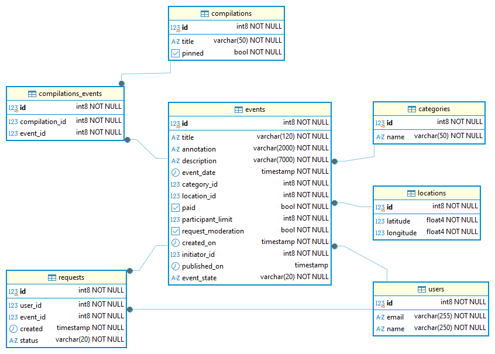
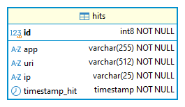

# Explorer With Me
Проект Explorer With Me состоит из двух сервисов: основного и сервиса статистики.

## Основной сервис
API основного сервиса имеют три части:

    1. публичная доступна без регистрации любому пользователю сети;
    2. закрытая доступна только авторизованным пользователям;
    3. административная — для администраторов сервиса.

### Возможности публичного API
Публичный API предоставляет возможности поиска и фильтрации событий:

    1. сортировка списка событий организована либо по количеству просмотров, которое запрашивается в сервисе статистики,
       либо по датам событий;
    2. при просмотре списка событий возвращается только краткая информация о мероприятиях;
    3. просмотр подробной информации о конкретном событии возможен через отдельный эндпоинт;
    4. каждое событие относится к какой-то из закреплённых в приложении категорий;
    5. настроена возможность получения всех имеющихся категорий и подборок событий 
       (такие подборки будут составлять администраторы ресурса);
    6. каждый публичный запрос для получения списка событий или полной информации о мероприятии фиксируется сервисом статистики.

### Возможности API для авторизованных пользователей
Закрытая часть API реализует возможности зарегистрированных пользователей продукта:

    1. авторизованные пользователи имеют возможность добавлять в приложение новые мероприятия, редактировать их и просматривать после добавления;
    2. настроена подача заявок на участие в интересующих мероприятиях;
    3. создатель мероприятия имеет возможность подтверждать заявки, которые отправили другие пользователи сервиса.

### Возможности API для администратора
Административная часть API предоставляет возможности настройки и поддержки работы сервиса:

    1. настроено добавление, изменение и удаление категорий для событий;
    2. есть возможность добавлять, удалять и закреплять на главной странице подборки мероприятий;
    3. есть модерацию событий, размещённых пользователями, — публикация или отклонение;
    4. настроено управление пользователями — добавление, активация, просмотр и удаление.

### ER-диаграмма

## Сервис статистики
Функционал сервиса статистики содержит:

    1. возможность записи информации о том, что был обработан запрос к эндпоинту API;
    2. предоставление статистики за выбранные даты по выбранному эндпоинту.

### ER-диаграмма

## Спецификация API
Для обоих сервисов разработаны подробные спецификации API:

    1. спецификация основного сервиса: ewm-main-service-spec.json;
    2. спецификация сервиса статистики: ewm-stats-service.json.
